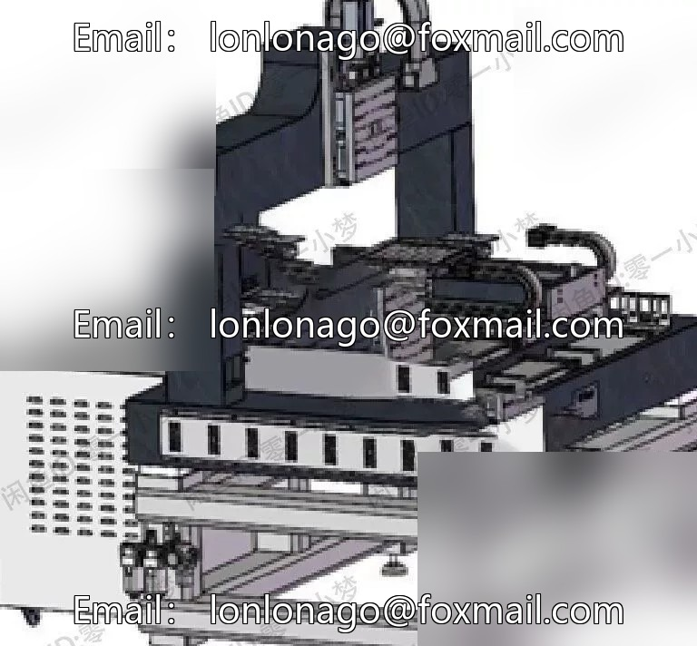
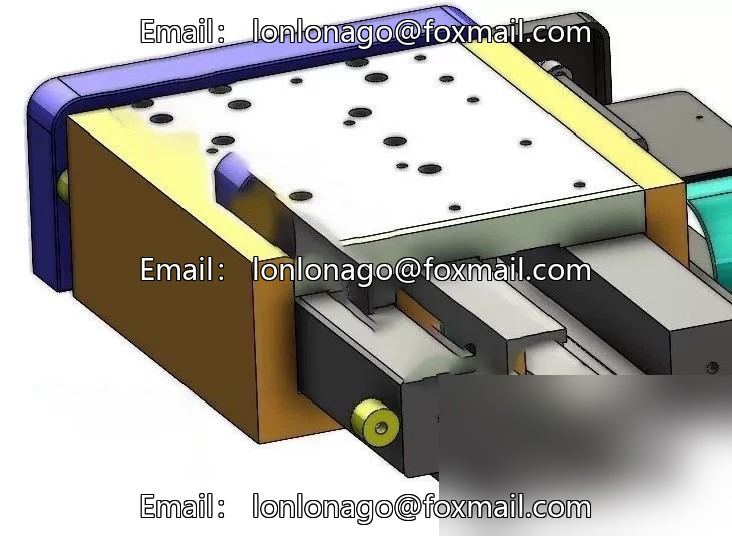
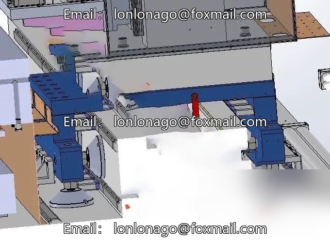
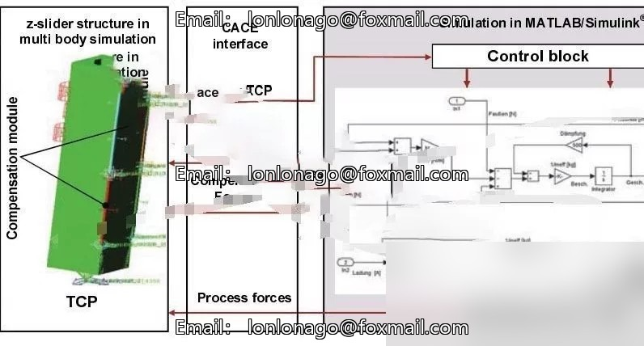
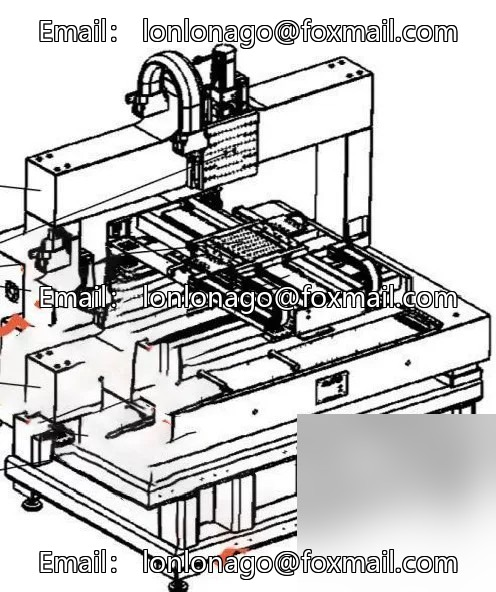
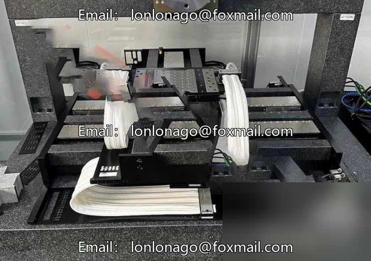
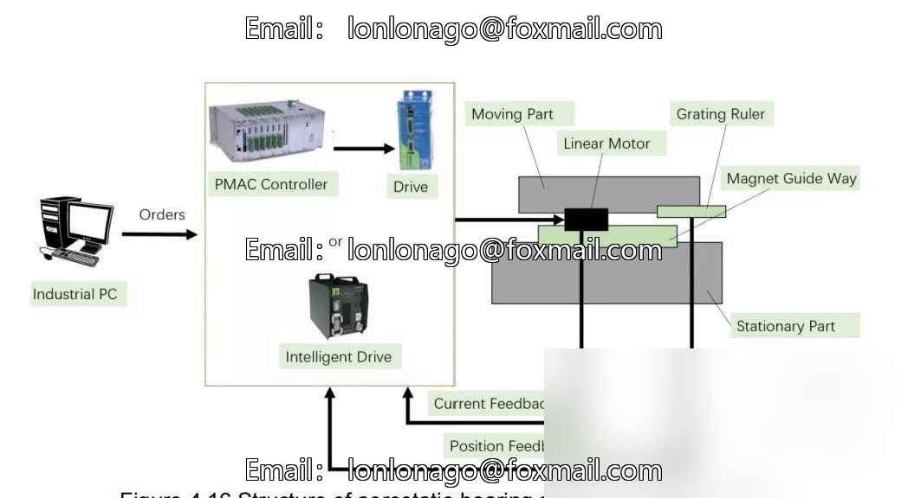

# Precision Floating Platform Core Technology Information: Internal materials from abroad, covering high-end precision.

## Body

Precision Floating Platform Core Technology Materials: Internal materials from abroad, covering the design and control technology of high-end precision floating platforms as well as finite element analysis technology! And the detailed study of static pressure air flotation guide rail
Absolutely invaluable! Over 400 pages in PDF format! The most comprehensive version available! First-time release.
[Fire] After a positive review, you can receive a complete and detailed 3D diagram of the air flotation platform in two sets.

## Images

## Payment

Here is a pay link on Stripe ( https://buy.stripe.com/3cs8yP7sY87d0vu9AB ). Please contact me lonlonago@foxmail.com after funding $89, and I will send you a complete data files , thank you!

